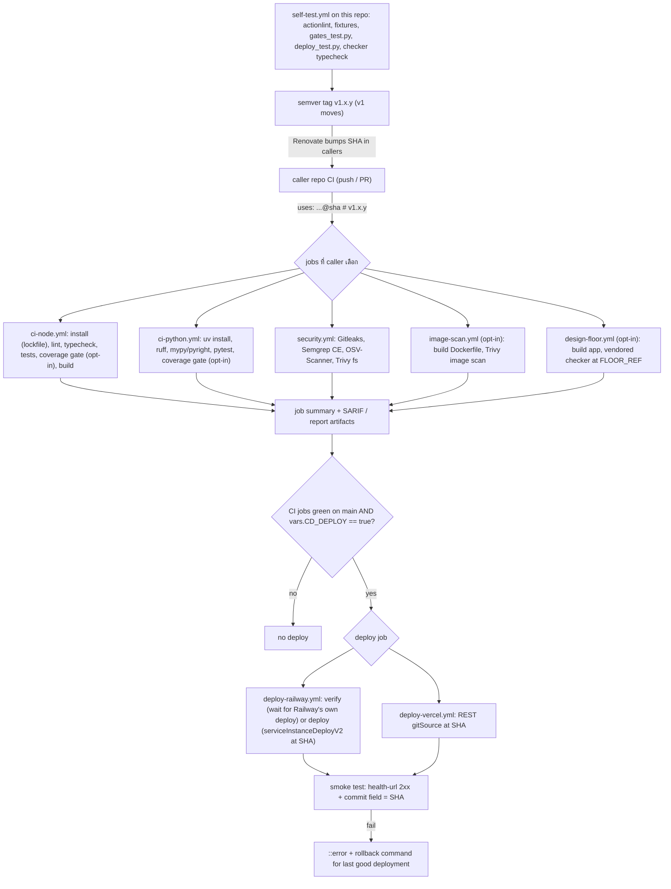

# 01 — Business process (As-Is / To-Be)

platform-ci-workflows คือชุด reusable GitHub Actions workflows (`workflow_call`) ที่ repository ของ owner เรียกใช้โดย pin commit SHA เพื่อได้ CI, security scan, deploy verification และ design-floor check ชุดเดียวกัน แทนการ copy CI ไปทุก repo; client repositories ไม่ใช้

Last reviewed: 2026-11-28 · commit `493a7f5`

## As-Is (จากโค้ดวันนี้)

Sources: `.github/workflows/ci-node.yml`, `.github/workflows/ci-python.yml`, `.github/workflows/security.yml`, `.github/workflows/image-scan.yml`, `.github/workflows/design-floor.yml`, `.github/workflows/deploy-railway.yml`, `.github/workflows/deploy-vercel.yml`, `.github/workflows/self-test.yml`, `tests/gates_test.py`, `tests/deploy_test.py`, `design-floor/SOURCE.md`, `renovate.json`, `README.md`

ข้อเท็จจริงจากโค้ดและ README:

- ทุก workflow รับ input `runner` (JSON `runs-on`): public ใช้ `ubuntu-24.04`, private ใช้ label self-hosted; README ยังเขียนถึง runner บน Railway ส่วน `PRODUCT.md` เขียนว่า "self-hosted runner pool" ว่า pool ไหนรับงาน private อยู่จริงวันนี้ [ต้องยืนยัน]
- `image-scan.yml` บน private ใช้ label `["self-hosted","linux","x64","docker"]` (rootless podman บนเครื่อง homelab ตาม README) [ต้องยืนยัน] สถานะเครื่อง
- deploy workflow ไม่เก็บ secret เอง: caller ส่ง `RAILWAY_TOKEN` / Vercel token ผ่าน `secrets:`
- release ล่าสุดที่เห็นใน tag: `v1.6.6`

## To-Be (`PRODUCT.md` §Measures, §Capabilities; `README.md` ส่วนที่บอกว่ายังไม่ทำ)

- `PRODUCT.md` §Measures: `self-test.yml` เขียวบน `main` เสมอ; callers อยู่บน release ล่าสุดของแต่ละ workflow ที่ใช้
- `PRODUCT.md` §Product Purpose: release ใหม่ต้องไม่ทำ caller พังเงียบ ๆ
- `README.md`: `deploy-vercel.yml` "Not adopted yet: needs the owner's OK under D9"; `services:` containers, Testcontainers และ ZAP บน runner ที่ไม่มี Docker "deferred to a later phase"; design floor ของ private repo รอให้ runner image มี library ของ Chromium

ไม่มี To-Be diagram ของกระบวนการทั้งหมดที่เขียนไว้ เป้าข้างบนเป็นรายการ ไม่ใช่ flow ใหม่

## Gap

| ID | As-Is → To-Be | Status | Owner | Evidence |
|---|---|---|---|---|
| G1 | `deploy-vercel.yml` มีแล้วแต่ยังไม่มี caller ใช้ → owner อนุมัติใช้ภายใต้ D9 | decide | owner | `README.md` workflow table (deploy-vercel row) |
| G2 | runner ของ private repo ไม่มี Docker: `services:` containers, Testcontainers, ZAP ยังไม่รองรับ → เฟสถัดไป | todo | owner | `README.md` §Where jobs run; ADR-0003 ใน architecture-docs |
| G3 | design floor ของ private repo ยังรันแบบ local report (runner image ไม่มี library ของ Chromium) → รันใน CI ด้วย runner self-hosted และ `install-browser-deps: false` | todo | claude | `README.md` §Design floor (Private repositories) |
| G4 | ยังไม่รู้ว่า callers ทุกตัวอยู่บน release ล่าสุดหรือไม่ จาก repo นี้ → callers อยู่บน release ล่าสุดของแต่ละ workflow | doing | claude | `PRODUCT.md` §Measures (R4 adoption report ครอบคลุมเฉพาะ job design-floor) |
| G5 | README ยังอธิบาย runner บน Railway ขณะที่ `PRODUCT.md` พูดถึง self-hosted pool → เอกสารตรงกับ runner ที่ใช้จริง | todo | claude | `README.md` §Where jobs run; `PRODUCT.md` §Positioning |
| G6 | ไม่มี To-Be ของกระบวนการ (เช่น adoption report ครบทุก workflow, เกณฑ์ปล่อย v2) → owner กำหนด | decide | owner | ไม่มีใน `PRODUCT.md` / `README.md` |

## Open questions

- private repo ใช้ runner pool ไหนอยู่จริงวันนี้ (Railway หรือ homelab) และ README ควรอัปเดตอย่างไร
- มีรายงานรวมว่า caller กี่ตัวอยู่บน release ล่าสุดของ `security.yml`, `ci-node.yml`, `ci-python.yml` หรือไม่ (นอกจาก R4 ที่ครอบคลุม design-floor)
